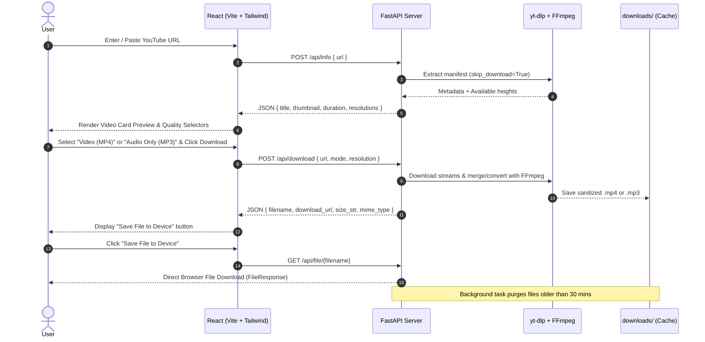

# StreamVault 🎬 — YouTube Video & Audio Downloader

<p align="center">
  
  
  
  
  
  
  
  
</p>

A modern, fast, and reliable YouTube Video and Audio Downloader web application. Built with a decoupled architecture featuring a **React + Vite + Tailwind CSS** frontend, an asynchronous **FastAPI + yt-dlp** backend, and seamless **Docker** containerization.

---

## 📑 Table of Contents

- [Key Features](#-key-features)
- [Architecture & Data Flow](#-architecture--data-flow)
- [Tech Stack](#-tech-stack)
- [Project Layout](#-project-layout)
- [Prerequisites](#-prerequisites)
- [Quick Start: Local Development](#-quick-start-local-development)
  - [1. Backend Setup](#1-backend-setup)
  - [2. Frontend Setup](#2-frontend-setup)
- [Running with Docker](#-running-with-docker)
  - [Option A: Docker Compose (Multi-Container)](#option-a-docker-compose-multi-container-recommended)
  - [Option B: Single All-in-One Docker Container](#option-b-single-all-in-one-docker-container)
- [REST API Reference](#-rest-api-reference)
- [Configuration & Environment Variables](#-configuration--environment-variables)
- [Troubleshooting & FAQ](#-troubleshooting--faq)
- [License](#-license)

---

## 🌟 Key Features

- **⚡ Instant Metadata Extraction**: Fetches high-resolution video thumbnail, title, channel name, duration, and view count in milliseconds without downloading media.
- **🎞️ Dynamic Video Resolutions**: Introspects video manifests to provide available resolutions (`Best Available`, `1080p`, `720p`, `480p`, `360p`, etc.) and multiplexes separate video and audio tracks into a clean MP4 container via FFmpeg.
- **🎵 High-Fidelity MP3 Audio**: Extracts audio stream and converts it directly to constant bitrate 192 kbps MP3.
- **💾 Direct Browser Downloads**: Streams processed media directly to the client's browser with standard `Content-Disposition: attachment` headers.
- **🛡️ Ephemeral & Privacy-Focused Cache**:
  - Automatically deletes processed files older than 30 minutes to prevent storage bloat.
  - One-click file deletion and full server cache purge through the integrated **Storage Manager** modal.
- **🎨 Modern Glassmorphic UI**:
  - Built with Tailwind CSS and Lucide React icons.
  - Features real-time state feedback, loading spinners, clipboard paste shortcuts, and sample video links.

---

## 📐 Architecture & Data Flow



---

## 🛠️ Tech Stack

| Layer | Technologies | Description |
| :--- | :--- | :--- |
| **Frontend** | React 18, Vite 6, Tailwind CSS 3, Lucide React | Modern SPA with responsive dark mode, glassmorphism, and instant feedback |
| **Backend** | FastAPI, Uvicorn, Pydantic | High-performance asynchronous REST API |
| **Downloader Engine** | `yt-dlp`, FFmpeg | Stream extraction, format parsing, and audio/video muxing |
| **Package Management** | `uv`, `npm` | Fast Python and JavaScript dependency resolution |
| **Containerization** | Docker, Docker Compose, Nginx | Multi-stage production builds and container orchestration |

---

## 📁 Project Layout

```text
YT-video-dwn/
├── backend/                             # Python / FastAPI Backend
│   ├── app/
│   │   ├── __init__.py
│   │   ├── main.py                      # REST endpoints, CORS & static file mounting
│   │   ├── downloader.py                # yt-dlp extraction & FFmpeg media conversion
│   │   └── config.py                    # Paths, TTL settings, and origins
│   ├── downloads/                       # Ephemeral directory for processed files
│   ├── pyproject.toml                   # uv project definition
│   ├── requirements.txt                 # Python dependencies
│   ├── Dockerfile                       # Python 3.12-slim + FFmpeg container
│   └── .dockerignore
│
├── frontend/                            # React + Vite Frontend
│   ├── src/
│   │   ├── components/
│   │   │   ├── Navbar.jsx               # Header with branding & storage counter
│   │   │   ├── UrlInput.jsx             # Input bar with clipboard paste & sample button
│   │   │   ├── VideoCard.jsx            # Video preview, author, views & duration badge
│   │   │   ├── DownloadOptions.jsx      # Video vs MP3 toggle & resolution pills
│   │   │   ├── DownloadResult.jsx       # Success state & browser download trigger
│   │   │   ├── StorageModal.jsx         # Server cache stats & 1-click purge modal
│   │   │   └── Notification.jsx         # Error & status alerts
│   │   ├── services/
│   │   │   └── api.js                   # API client communicating with /api
│   │   ├── App.jsx                      # Main state orchestration
│   │   ├── index.css                    # Tailwind CSS directives
│   │   └── main.jsx                     # React root mount
│   ├── index.html                       # HTML template with dark theme
│   ├── vite.config.js                   # Vite config with backend proxy
│   ├── tailwind.config.js               # Tailwind design system configuration
│   ├── postcss.config.js                # PostCSS setup
│   ├── package.json                     # Node.js dependencies & scripts
│   ├── nginx.conf                       # Production Nginx reverse-proxy configuration
│   ├── Dockerfile                       # Multi-stage frontend container (Node 22 + Nginx)
│   └── .dockerignore
│
├── docker-compose.yml                   # Multi-service configuration (Frontend + Backend)
├── Dockerfile                           # Single unified multi-stage container
├── .dockerignore
└── README.md
```

---

## 📋 Prerequisites

Before running locally, ensure you have:
- **Python**: Version `3.12` or higher (we recommend [`uv`](https://github.com/astral-sh/uv) for fast package management)
- **Node.js**: Version `18.x` or higher and `npm`
- **FFmpeg**: Must be installed and accessible in your system `PATH` (used by yt-dlp to merge video/audio and convert to MP3)

> [!TIP]
> **Check your FFmpeg installation:**
> ```bash
> ffmpeg -version
> ```
> On Windows: `winget install Gyan.FFmpeg` or `choco install ffmpeg`  
> On macOS: `brew install ffmpeg`  
> On Linux: `sudo apt install ffmpeg`

---

## 🚀 Quick Start: Local Development

### 1. Backend Setup

From the root directory:

```bash
# Option A: Using uv (Recommended)
uv run uvicorn backend.app.main:app --port 8000 --reload

# Option B: Using standard Python venv
python -m venv .venv
source .venv/bin/activate    # On Windows: .venv\Scripts\activate
pip install -r backend/requirements.txt
uvicorn backend.app.main:app --port 8000 --reload
```

- **Backend API**: `http://127.0.0.1:8000`
- **Swagger Documentation**: `http://127.0.0.1:8000/docs`

---

### 2. Frontend Setup

In a separate terminal:

```bash
cd frontend
npm install
npm run dev
```

- **Frontend App**: `http://127.0.0.1:5173`
- The Vite development server automatically proxies all `/api` requests to `http://127.0.0.1:8000`.

---

## 🐳 Running with Docker

### Option A: Docker Compose (Multi-Container) [Recommended]

Spins up the **FastAPI backend** (with system FFmpeg) and the **Frontend** (compiled and served via high-performance Nginx reverse proxy):

```bash
docker compose up --build
```

- **Frontend Web UI**: [http://localhost:3000](http://localhost:3000)
- **Backend API**: [http://localhost:8000](http://localhost:8000)
- **Swagger Docs**: [http://localhost:8000/docs](http://localhost:8000/docs)

To run in the background (detached mode):
```bash
docker compose up -d --build
```
To stop the services:
```bash
docker compose down
```

---

### Option B: Single All-in-One Docker Container

Builds the React frontend and packages it directly inside the FastAPI container, serving both the API and the web app from a single port (`8000`):

```bash
docker build -t streamvault .
docker run -d -p 8000:8000 --name streamvault-app streamvault
```

Access the entire application at: [http://localhost:8000](http://localhost:8000)

---

## 📡 REST API Reference

### 1. Health Check
- **`GET /api/health`**
- **Response**:
  ```json
  {
    "status": "ok",
    "timestamp": 1729725600.0
  }
  ```

---

### 2. Fetch Video Metadata
- **`POST /api/info`**
- **Request Body**:
  ```json
  {
    "url": "https://www.youtube.com/watch?v=jNQXAC9IVRw"
  }
  ```
- **Response**:
  ```json
  {
    "id": "jNQXAC9IVRw",
    "title": "Me at the zoo",
    "thumbnail": "https://i.ytimg.com/vi/jNQXAC9IVRw/hqdefault.jpg",
    "duration_str": "00:19",
    "duration_seconds": 19,
    "author": "jawed",
    "view_count": 446063319,
    "description": "The first video on YouTube.",
    "resolutions": ["Best Available", "240p", "144p"]
  }
  ```

---

### 3. Download & Process Media
- **`POST /api/download`**
- **Request Body**:
  ```json
  {
    "url": "https://www.youtube.com/watch?v=jNQXAC9IVRw",
    "mode": "Video (MP4)",
    "resolution": "Best Available"
  }
  ```
  *(For audio only, pass `"mode": "Audio Only (MP3)"`)*
- **Response**:
  ```json
  {
    "success": true,
    "filename": "Me_at_the_zoo-jNQXAC9IVRw-af1571d7.mp4",
    "download_url": "/api/file/Me_at_the_zoo-jNQXAC9IVRw-af1571d7.mp4",
    "file_size": 533915,
    "size_str": "521.4 KB",
    "mime_type": "video/mp4",
    "mode": "Video (MP4)",
    "resolution": "Best Available"
  }
  ```

---

### 4. Direct Browser File Download
- **`GET /api/file/{filename}`**
- **Response**: Binary file stream with `Content-Disposition: attachment; filename="{filename}"`.

---

### 5. Delete Server File
- **`DELETE /api/file/{filename}`**
- **Response**:
  ```json
  {
    "success": true,
    "message": "Deleted Me_at_the_zoo-jNQXAC9IVRw-af1571d7.mp4"
  }
  ```

---

### 6. Storage Stats & Cache Purge
- **`GET /api/cache/stats`**:
  ```json
  {
    "file_count": 2,
    "total_bytes": 1048576,
    "size_str": "1.0 MB"
  }
  ```
- **`DELETE /api/cache`**:
  ```json
  {
    "success": true,
    "deleted_count": 2
  }
  ```

---

## ⚙️ Configuration & Environment Variables

| Variable | Scope | Default | Description |
| :--- | :--- | :--- | :--- |
| `VITE_BACKEND_URL` | Frontend | `http://127.0.0.1:8000` | Target URL for backend API proxy in Vite |
| `MAX_FILE_AGE_SECONDS`| Backend | `1800` (30 min) | Lifetime of cached files before automatic purge |
| `CORS_ORIGINS` | Backend | Localhost ports | Allowed origins for cross-origin requests |

---

## ❓ Troubleshooting & FAQ

<details>
<summary><b>1. "Download failed: ffmpeg is not installed"</b></summary>

Ensure FFmpeg is installed and added to your system `PATH`. Open a terminal and run `ffmpeg -version`. If running via Docker, FFmpeg is already bundled inside the container automatically.
</details>

<details>
<summary><b>2. "Sign in to confirm your age" or "Video unavailable"</b></summary>

Age-restricted, paid, or private YouTube videos require user authentication cookies. StreamVault gracefully surfaces these restrictions and prompts you to try public content.
</details>

<details>
<summary><b>3. How are files automatically cleaned up?</b></summary>

Files in [`backend/downloads`](file:///D:/YT-video-dwn/backend/downloads) are timestamp-checked on server startup and after every download request. Any file older than 30 minutes is automatically unlinked. You can also purge the cache anytime in the UI via the **Server Storage** button in the header.
</details>

<details>
<summary><b>4. How does the frontend proxy work in development?</b></summary>

In [`frontend/vite.config.js`](file:///D:/YT-video-dwn/frontend/vite.config.js), Vite is configured to route `/api/*` requests directly to `http://127.0.0.1:8000`, preventing CORS issues during local development.
</details>

---

## 📄 License

This project is open-source and available under the [MIT License](LICENSE).
